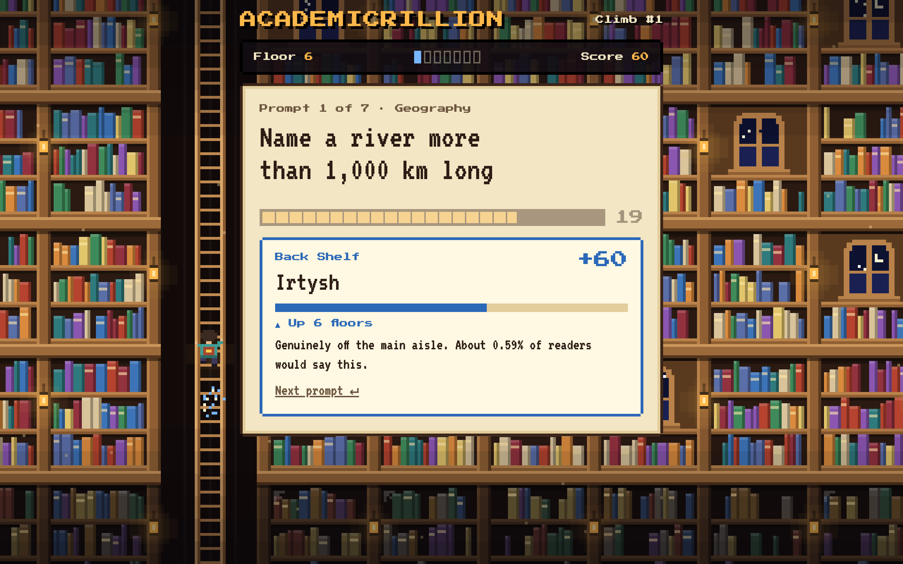

# Academicrillion

A trivia game set in a library tower. Each prompt has hundreds of right answers, and the rarer the one you give, the higher you climb.

**Play it: https://patrickjykang.github.io/academicrillion/**



## How it plays

- There are two ways up. The **daily climb** is the same seven prompts for everyone and can be played once a day. **Unlimited climbs** are numbered and never run out.
- A climb is seven prompts, such as "Name a tectonic plate" or "Name a paradox".
- You see each prompt for 3 seconds, then have 25 seconds to type one answer.
- A guess that isn't in the catalogue costs nothing. Keep trying until the clock runs out.
- A near-miss spelling is offered back ("Did you mean…?") and counts if you confirm it or the clock runs out first.
- The fewer people who would give your answer, the more it scores:

  | Shelf | Points | |
  |---|---|---|
  | Lost Manuscript | 100 | the single rarest answer in the catalogue |
  | Dusty Tome | 85 | hardly anyone names it |
  | Back Shelf | 60 | off the main aisle |
  | Well-Thumbed | 30 | solid, but common |
  | Book Club Pick | 15 | feels obscure, but everyone reaches for it |
  | Bestseller | 10 | the first answer on everyone's tongue |

- Ten points is one floor. A perfect climb is 700 points, the lantern room on floor 70.
- A given climb number always has the same seven prompts, and no prompt comes back until the others have had a turn.
- There are no other players. The "other climbers" you are ranked against are 2,000 simulated ones.
- Your climbing log is kept in your browser only.

## The daily climb

- Seven prompts from seven different subjects, the same for everyone on the same date.
- A new one starts at midnight UTC, at the same moment for everyone. Day 1 was 11 November 2026.
- It can be played once. Progress is saved after every prompt, so it can be resumed, but a prompt that was on screen when the page was closed counts as missed.
- A prompt comes back in the daily about six weeks after it was last used.
- The schedule is pinned in `js/data-daily.js`, so that adding or removing a prompt does not reshuffle a day people have already played. After changing the prompts, run `node tools/build-daily.js`: it keeps every day up to tomorrow and chooses the later ones again.

### What is recorded

Two things are recorded, for diagnostics. Neither holds a name, account or address; both hold a random id made up by the browser.

- **Daily climbs**, to see which prompts are too hard and which real answers the catalogues are missing: the day's number, the score and, for each prompt, the answer given, the guesses that were turned away and the time taken.
- **Visits**, to see how many people come: one record per browser per day the game is opened, with how many unlimited climbs it started and finished that day. What was answered in an unlimited climb is not recorded.

Records go to a small Cloudflare Worker (`worker/`), which stores them in a D1 database. The Worker only takes records in: nothing can be read back over the web, and it stores nothing about the sender. Its address is `ENDPOINT` at the top of `js/record.js`. If a record cannot be delivered it waits in the browser and is sent on a later visit. A copy of the game running on `localhost` sends nothing.

To look at the records, run queries with Wrangler from the `worker/` folder (you need to be signed in to the Cloudflare account that owns the database).

Traffic, one row per day: visitors, how many of them were new, who played the daily, and how many unlimited climbs were played:

```bash
npx wrangler d1 execute academicrillion --remote --command "SELECT * FROM traffic"
```

A visitor is a browser, so one person on a phone and a laptop counts twice. Visits have been counted since 12 November 2026; earlier days show daily players only.

How the daily went, day by day:

```bash
npx wrangler d1 execute academicrillion --remote --command "SELECT day, COUNT(*) AS players, SUM(done) AS finished, ROUND(AVG(score)) AS average FROM climbs GROUP BY day ORDER BY day"
```

The guesses that were turned away most often are the likeliest missing answers:

```bash
npx wrangler d1 execute academicrillion --remote --command "SELECT prompt, lower(guess) AS guess, COUNT(*) AS times FROM guesses WHERE kind = 'miss' GROUP BY prompt, lower(guess) ORDER BY times DESC LIMIT 50"
```

And the prompts people find hardest:

```bash
npx wrangler d1 execute academicrillion --remote --command "SELECT prompt, COUNT(*) AS plays, ROUND(AVG(score)) AS average, SUM(answer IS NULL) AS unanswered FROM rounds GROUP BY prompt ORDER BY average LIMIT 30"
```

`worker/schema.sql` describes the `climbs` and `visits` tables and the `rounds`, `guesses` and `traffic` views. To change the Worker, edit `worker/src/index.js` and run `npx wrangler deploy` from `worker/`. After changing the schema, run `npx wrangler d1 execute academicrillion --remote --file schema.sql` there too.

## What it asks about

308 prompts and about 72,000 accepted answers, across 18 subjects. A climb takes at most two prompts from any one subject.

| | | |
|---|---|---|
| Physics & Chemistry (12) | Astronomy & Space (14) | Earth Science (14) |
| Life Science (20) | Mathematics (12) | Medicine & Psychology (15) |
| Technology & Engineering (13) | History (34) | Geography (48) |
| Language (12) | Literature (20) | Art & Architecture (15) |
| Music & Theatre (14) | Philosophy (10) | Religion & Mythology (15) |
| Politics & Law (19) | Economics (13) | Academia (8) |

Popular culture, sport and food are left out on purpose.

## Run it locally

There is no build step and nothing to install. Serve the folder with any static server:

```bash
python3 -m http.server 5173
```

Then open http://localhost:5173/.

To run the tests (Node 18 or newer):

```bash
node test/engine.test.js
```

```bash
node test/record.test.js
```

```bash
node test/worker.test.mjs
```

## Where the answers come from

A category is one of two kinds.

- **Complete.** The whole set is written out by hand in `js/data-lists.js`: the 88 constellations, the books of the Bible, the colleges of Oxford and Cambridge.
- **Deep.** The best-known answers are ranked by hand, and the rest of the category comes from [Wikidata](https://www.wikidata.org/). An answer's familiarity is taken from how many language editions of Wikipedia have an article on it.

The deep catalogues are built in three steps:

1. `tools/sources.js` holds one Wikidata query per category.
2. `node tools/fetch-tails.js` downloads each set into `tools/cache/`. Sets already there are skipped.
3. `node tools/build-tails.js` filters out what doesn't belong, merges each set with its hand-ranked list and writes `js/data-tails.js`. That file is generated; don't edit it by hand.

The downloaded sets are checked in, so step 3 works without a network connection.

## Adding a category

1. Add an entry to `js/data-lists.js`. The comment at the top of the file explains the format.
2. For a deep category, add its query to `tools/sources.js` under the same id, then run the fetch and build steps. Run the build with `--sample` to see what came back, and add a filter in `tools/build-tails.js` if the set is noisy.
3. Run `node tools/build-daily.js` so the new prompt joins the daily rotation.
4. Run the tests.
5. Bump the `?v=` number on the files in `index.html` so browsers pick up the change.

## Layout

```
index.html, style.css   the page
js/data-lists.js        hand-ranked lists, one per category
js/data-geo.js          countries, capitals, US states
js/data-elements.js     chemical elements
js/data-tails.js        deep catalogues (generated)
js/data-daily.js        which prompts each day's daily climb gets (generated)
js/engine.js            matching, scoring, scheduling, simulated players
js/app.js               the game screens
js/record.js            records daily climbs and counts visits
js/scene.js             the tower drawn behind them
tools/                  the Wikidata download and build scripts, and their cache
tools/build-daily.js    pins the daily schedule
worker/                 the Cloudflare Worker and database schema that receive the records
test/                   data, engine, recorder and Worker checks
```

## Things to know

- The percentages shown with an answer ("about 2% of readers would say this") are worked out from its rank in the list. They are not measured from real players.
- The fact shown with each 100-point answer was written by hand and has not been independently checked.
- Sets that are written out by hand and still growing go out of date: each year's Booker and Pulitzer winners, a new US national park, a new head of government. They were last checked on 12 November 2026.
- Wikidata's categories are noisy. The filters remove the worst of it, but some odd answers will remain in the deep catalogues.
- The data is Wikidata as it stood in November 2026, downloaded through [QLever](https://qlever.dev/), a public mirror run by the University of Freiburg. Wikidata's content is CC0.
- The format is inspired by the daily dive at [krillion.io](https://krillion.io/). This is an independent project and is not affiliated with it.

## Licence

Academicrillion is free software, released under the [GNU General Public License, version 3](LICENSE).
